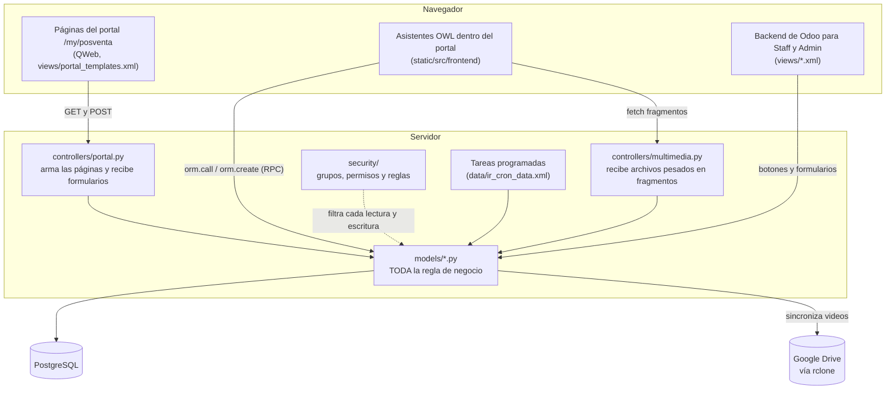
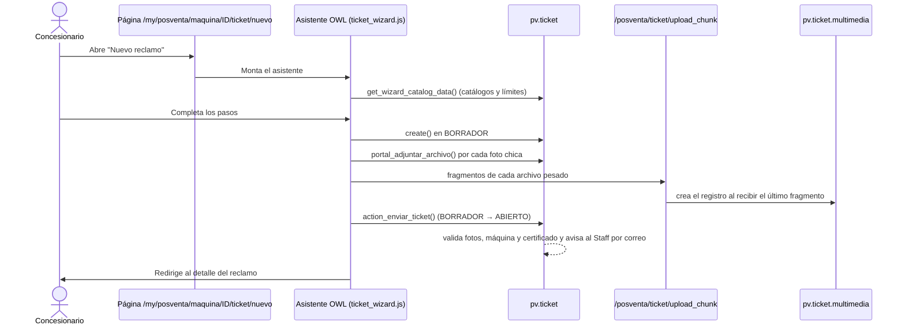

# Arquitectura

## Las capas

**Regla de oro: la lógica vive en los modelos.** Los controllers y el JavaScript solo muestran datos y llaman
métodos del modelo. Cada método valida por su cuenta quién lo llama (grupo, concesionario) y en qué estado está
el registro. Así da igual si la acción llega desde el portal, desde el backend o desde una llamada RPC armada a
mano: las reglas se cumplen igual. Los tests `test_security_hardening.py` prueban justamente eso.

## Qué hay en cada carpeta

| Carpeta / archivo | Contenido |
|---|---|
| `models/pv_maquina.py` | Máquina: estados, liberación (solicitud y aprobación) y traslados entre concesionarios. |
| `models/pv_certificado.py` | Certificados: secuencia FRU → FEU → CPM, plazos de carga, vigencia para reclamos y crons de vencimiento. |
| `models/pv_ticket.py` | Reclamo: clasificación, validaciones, permisos por campo y estado, y todas las transiciones de estado. |
| `models/pv_ticket_multimedia.py` | Archivos pesados de un reclamo, límites de subida y sincronización con Google Drive. |
| `models/pv_ticket_medida.py` | Medidas de seguimiento y su cron de vencimiento. |
| `models/pv_concesionario.py` | Concesionario y **definición de pertenencia** (qué usuario pertenece a qué concesionario). |
| `models/pv_sistema.py`, `pv_subsistema.py`, `pv_problema.py`, `pv_subsistema_campo.py` | Catálogo técnico para reclamos Post-PM y sus campos adicionales. |
| `models/pv_tipo_desvio.py`, `pv_tipo_rechazo.py` | Catálogos de tipos de desvío (Pre-PM) y motivos de rechazo / sin cobertura. |
| `models/pv_dashboard.py` | Tablero del Staff con contadores y T1/T2/T3. |
| `models/res_config_settings.py` | Ajustes del módulo (plazos, Google Drive, límites de subida). |
| `controllers/portal.py` | [Rutas](odoo.md#controllers-y-rutas) `/my/posventa/...` del portal. Lee como el usuario logueado y traduce errores a mensajes. |
| `controllers/multimedia.py` | `/posventa/ticket/upload_chunk`: arma archivos pesados a partir de fragmentos. |
| `wizard/` | Asistentes del backend (cerrar reclamo, liberar, trasladar, adjuntar video, importar Excel) y el alta de acceso al portal. |
| `views/portal_templates.xml` | Todas las páginas del portal ([QWeb](odoo.md#vistas-qweb-y-owl)). |
| `views/*_views.xml`, `views/pv_menu.xml` | Pantallas y menús del backend. |
| `static/src/frontend/` | JavaScript del portal ([OWL](odoo.md#vistas-qweb-y-owl)): asistente de reclamo, asistente de certificado y subida de archivos. |
| `static/src/backend/` | Widget del backend para subir videos por fragmentos. |
| `static/src/shared/chunk_upload.js` | Subida por fragmentos, compartida por portal y backend. |
| `security/` | [Grupos](odoo.md#grupos), [permisos por modelo](odoo.md#permisos-de-acceso) (`ir.model.access.csv`) y [reglas de registro](odoo.md#reglas-de-registro) (`pv_security.xml`). |
| `data/` | Datos iniciales: secuencia de tickets, catálogos, crons, plantillas de correo y ajustes por defecto. |
| `migrations/` | [Scripts de migración](odoo.md#scripts-de-migración) que adaptan bases existentes al cambiar de versión. |
| `tests/` | Tests automáticos. Son también la mejor documentación de cada regla: cada test describe un caso. |
| `tools/documentacion.py` | Genera `docs/referencia.md`. |

La lista completa de modelos, campos y métodos, y quién llama a cada método, está en la
[referencia generada](referencia.md).

## Cómo viaja un pedido

### Un concesionario crea un reclamo

Si una subida falla, el ticket ya existe en BORRADOR: el asistente ofrece reintentar, seguir sin ese archivo o
dejarlo en borrador para completarlo después.

### Un archivo pesado llega a Google Drive

1. El navegador corta el archivo en fragmentos (768 KB por defecto) y los manda a `/posventa/ticket/upload_chunk`.
2. El controller los guarda en una carpeta temporal y, con el último, arma el archivo y crea un
   `pv.ticket.multimedia` en estado *Sincronizando*.
3. El cron "Sincronizar multimedia pendiente a Google Drive" lo sube con `rclone`, guarda el enlace y lo deja
   *Disponible*. Si falla, reintenta con espera creciente (hasta 5 veces) y avisa en el chatter.
4. En modo de almacenamiento "Odoo" no hay Drive: el archivo queda como adjunto normal del ticket (tope 200 MB).

## Decisiones de diseño que conviene conocer

- **El portal lee como el usuario.** Las páginas no usan `sudo()`: las reglas de registro garantizan que un
  concesionario no vea lo de otro. Cuando hay que mostrar el nombre de algo que el usuario no puede leer (el
  cliente final, el responsable del Staff), se usa un [campo *related*](odoo.md#campos-related) de texto, como `cliente_nombre`: Odoo los
  calcula como superusuario y solo expone ese texto. Ver [Seguridad](seguridad.md).
- **El estado del ticket solo cambia con métodos `action_*`.** `write()` rechaza `estado` si no viene de
  `_write_estado()`. Cada acción valida grupo y estado de origen.
- **Qué campo puede cambiar quién** está en tres listas al principio de `pv_ticket.py`
  (`CAMPOS_CARGA_CONCESIONARIO`, `CAMPOS_POST_ENVIO_CONCESIONARIO`, `CAMPOS_SOLO_STAFF`). Al agregar un campo al
  ticket hay que decidir en cuál va.
- **Notas en el [chatter](odoo.md#chatter)** con `_message_log()` de Odoo: quedan como nota interna, sin notificar a nadie.
- **Los crons son [`noupdate`](odoo.md#archivos-de-datos-y-noupdate).** Si cambia el método que llama un cron, hay que actualizar el registro existente
  con un script de migración (ver `migrations/19.0.1.1.0/post-migrate.py`).

## Ver también

- [Conceptos de Odoo](odoo.md): explicación de cada pieza de Odoo nombrada acá.
- [Referencia](referencia.md): todos los modelos, campos y quién llama a cada método.
- [Documentación oficial para desarrolladores de Odoo 19](https://www.odoo.com/documentation/19.0/developer.html)
