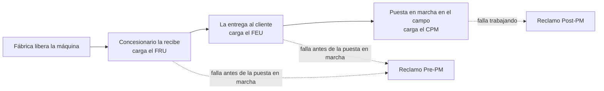

# Conceptos

## La idea central: todo gira alrededor de la máquina

Cada máquina que fabrica Crucianelli se identifica por su **OF** (Orden de Fabricación) y queda asignada a
un **concesionario**. A lo largo de su vida la máquina junta documentos (certificados) y, si falla, reclamos.
Un reclamo solo se acepta si la máquina tiene el certificado que lo respalda vigente.

## Quién usa el módulo

| Rol | Dónde trabaja | Qué hace |
|---|---|---|
| Concesionario | Portal web `/my/posventa` | Ve solo lo de su empresa: máquinas, certificados y reclamos. Carga certificados, crea y envía reclamos, adjunta fotos, propone y acepta traslados, pide liberaciones. |
| Staff Call Center | Backend de Odoo | Ve todas las máquinas y todos los reclamos enviados. Toma reclamos, carga medidas de seguimiento, acepta, rechaza y cierra. |
| Administrador de Posventa | Backend de Odoo | Todo lo del Staff, más concesionarios y su acceso al portal, catálogos, importación de máquinas, liberaciones, retrocesos de estado y ajustes. |

## Glosario

| Término | Significado |
|---|---|
| **OF** | Orden de Fabricación. Identifica la máquina; es única. |
| **Concesionario** | Empresa de la red que vende y atiende las máquinas. En Odoo es un `pv.concesionario` ligado a una empresa (`res.partner`); sus empleados son contactos de esa empresa con acceso al portal. |
| **Cliente** | El productor dueño final de la máquina. Es un contacto de Odoo; el concesionario ve solo su nombre. |
| **Liberada** | Estado de la máquina recién salida de fábrica (o reiniciada): todavía no tiene certificados. No admite reclamos. |
| **FRU** | Formulario de Recepción de Unidad. El concesionario lo carga al recibir la máquina; la pasa a STOCK. |
| **FEU** | Formulario de Entrega de Unidad. Se carga al entregarla al cliente. Es requisito para el CPM. |
| **CPM** | Certificado de Puesta en Marcha. La máquina pasa a VENDIDA. No vence. |
| **Plazo de carga** | Días que tiene el concesionario, desde la liberación, para cargar el FRU o el FEU. Si lo carga tarde queda registrado el retraso. |
| **Vigencia para reclamos** | Días, desde la fecha del certificado, en que se pueden abrir reclamos con él (FRU y FEU). El CPM no vence. |
| **Reclamo Pre-PM** | Falla antes de la puesta en marcha. Se respalda en el FEU (o el FRU) y se clasifica por **tipo de desvío** (rotura, faltante…). |
| **Reclamo Post-PM** | Falla con la máquina trabajando. Se respalda en el CPM y se clasifica por **sistema → subsistema → problema**, con hectáreas trabajadas. |
| **Campos adicionales** | Preguntas extra que el admin define por subsistema (texto, número, lista, sí/no). Aparecen solas en el asistente de reclamo. |
| **Medida** | Acción de seguimiento de un reclamo con fecha de vencimiento (acción, medida, resolución parcial o definitiva). |
| **Rechazo del reclamo** | El concesionario cargó algo mal: el reclamo termina y debe crear uno nuevo. |
| **Sin cobertura de garantía** | El reclamo era válido pero la pieza la paga el concesionario o el cliente. Se indica al cerrar. |
| **T1 / T2 / T3** | Horas desde la creación del reclamo hasta que el Staff lo toma (T1), lo acepta (T2) y lo cierra (T3). |
| **Traslado** | Paso de una máquina en STOCK de un concesionario a otro. El destino debe aceptarlo; al aceptarlo la máquina vuelve a LIBERADA para el nuevo dueño. |
| **Liberación** | Reinicio de una máquina (canje): vuelve a LIBERADA y sus certificados se archivan. La hace el admin, a pedido del concesionario o directamente. |
| **Archivo pesado** | Video o archivo grande. Se sube en fragmentos y se guarda en Google Drive (o en Odoo, según el ajuste). |
