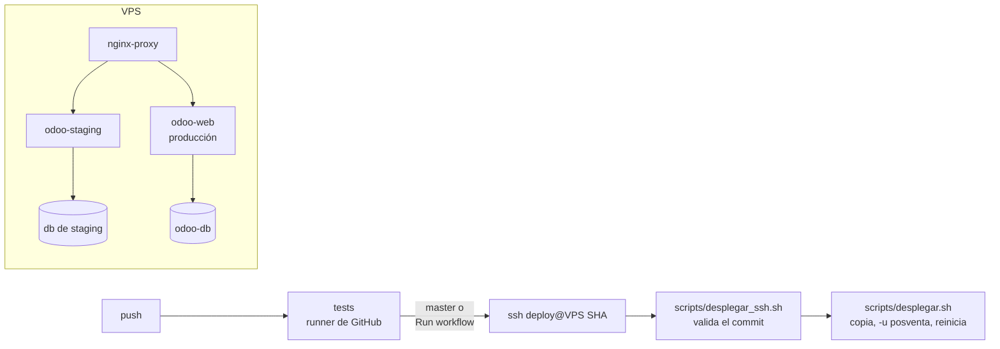

# Despliegue

Posventa se prueba en un **staging** que corre en el mismo VPS que producción, pero como un stack aparte: otro
Odoo, otra base de PostgreSQL y otra carpeta, publicado en `https://staging.portalcrucianelli.site` por el
mismo `nginx-proxy`. Producción no comparte base, código ni reinicios con staging.

Cada push corre los tests en GitHub Actions. Lo que llega a `master` (o lo que se lance a mano) se despliega en
staging por SSH, con una clave que solo puede ejecutar "desplegar este commit".



**Por qué no una base más en el Odoo de producción:** el código es compartido y cada despliegue reiniciaría
producción. Además, con dos bases en un mismo Odoo, los enlaces de invitación no indican la base y Odoo no sabe
a cuál mandar al usuario. Con un Odoo por base, ese problema no existe.

## 1. Preparar el VPS (una vez)

Los comandos se corren por SSH en el VPS. `~/mi-servidor` es la carpeta del compose de producción. Ahí solo se
agrega un archivo de nginx y un certificado.

### 1.1 Backup de producción

Aunque no se toca, conviene tenerlo antes de cambiar nada en el servidor:

```bash
cd ~/mi-servidor
docker compose exec -T odoo-db pg_dump -U odoo -Fc <base_de_produccion> > ~/backup-$(date +%F).dump
docker run --rm -v mi-servidor_odoo-web-data:/data -v ~:/backup alpine tar czf /backup/filestore-$(date +%F).tgz -C /data .
```

### 1.2 Dominio y certificado

1. En el DNS del dominio: registro `A` de `staging.portalcrucianelli.site` apuntando a la IP del VPS.
2. Certificado propio para staging. El bloque `listen 80` de `default.conf` ya atiende el desafío de certbot:
   ```bash
   cd ~/mi-servidor
   docker compose run --rm certbot certonly --webroot -w /var/www/certbot -d staging.portalcrucianelli.site
   ```

### 1.3 Usuario de despliegue

Un usuario sin contraseña, dueño del stack de staging, que puede usar Docker:

```bash
sudo adduser --disabled-password --gecos "" deploy
sudo usermod -aG docker deploy
docker network ls | grep red-web     # debe mostrar mi-servidor_red-web
```

Estar en el grupo `docker` equivale a ser root. Por eso la única forma de entrar como `deploy` es la clave del
paso 1.6, y esa clave solo puede desplegar.

### 1.4 Stack de staging

Como `deploy` (`sudo -iu deploy`):

```bash
git clone https://github.com/ffunes-cru/posventa.git ~/posventa
mkdir -p ~/odoo-staging/config ~/odoo-staging/addons
cp ~/posventa/docker/staging/docker-compose.yml ~/odoo-staging/
cp ~/posventa/docker/staging/odoo.conf ~/odoo-staging/config/
sed -i "s|admin_passwd = CAMBIAR|admin_passwd = $(openssl rand -base64 24)|" ~/odoo-staging/config/odoo.conf
(umask 077; openssl rand -base64 24 > ~/odoo-staging/pg_pass)
rsync -a --exclude .git ~/posventa/ ~/odoo-staging/addons/posventa/

cd ~/odoo-staging
docker compose build odoo
docker compose up -d db
docker compose run --rm odoo odoo -d staging -i posventa --stop-after-init   # crea la base "staging"
docker compose up -d odoo
```

Si el compose de producción no está en `~/mi-servidor`, corregir el nombre de la red en `networks.red-web.name`.
El Odoo de staging tiene un tope de 2 GB de RAM y su base, de 1 GB, para no quitarle memoria a producción.

### 1.5 nginx

Copiar el bloque de staging y recargar nginx. La recarga no corta las conexiones de producción, y `nginx -t`
evita recargar una configuración con errores:

```bash
sudo cp ~deploy/posventa/docker/staging/nginx-staging.conf ~/mi-servidor/nginx/staging.conf
docker exec nginx-proxy nginx -t && docker exec nginx-proxy nginx -s reload
```

Entrar a `https://staging.portalcrucianelli.site` con `admin` / `admin` y **cambiar esa contraseña enseguida**.

### 1.6 Clave SSH para GitHub Actions

1. En tu PC, generar una clave nueva, solo para esto:
   ```bash
   ssh-keygen -t ed25519 -N "" -C github-actions-staging -f ./staging_deploy
   ```
2. En el VPS, autorizarla para `deploy` **con comando forzado**. Esa clave no abre una consola: solo ejecuta
   `desplegar_ssh.sh`, que valida que el commit pedido esté en una branch del repo y lo despliega.
   ```bash
   sudo -iu deploy
   mkdir -p ~/.ssh && chmod 700 ~/.ssh
   clave='<pegar acá el contenido de staging_deploy.pub, la clave PÚBLICA>'
   echo "command=\"$HOME/posventa/scripts/desplegar_ssh.sh\",restrict $clave" >> ~/.ssh/authorized_keys
   chmod 600 ~/.ssh/authorized_keys
   printf 'ODOO_COMPOSE_DIR=%s\nODOO_DB=staging\nODOO_SERVICE=odoo\nODOO_URL=https://staging.portalcrucianelli.site\n' \
       ~/odoo-staging > ~/staging.env
   ```

### 1.7 GitHub

Desde tu PC, en la carpeta del repo y con `gh` logueado:

```bash
gh api -X PUT repos/ffunes-cru/posventa/environments/staging
gh secret set STAGING_SSH_KEY --env staging < ./staging_deploy
ssh-keyscan -t ed25519 <ip-del-vps> | gh secret set STAGING_KNOWN_HOSTS --env staging
gh variable set STAGING_SSH_DESTINO --env staging --body "deploy@<ip-del-vps>"   # otro puerto: ssh://deploy@<ip>:<puerto>
rm ./staging_deploy ./staging_deploy.pub
```

Comprobar que la huella que devuelve `ssh-keyscan` coincide con la del VPS
(`ssh-keygen -lf /etc/ssh/ssh_host_ed25519_key.pub` en el servidor).

Los secretos del environment no se entregan a los pull requests de forks. Además, el repo exige aprobar a mano
los workflows de colaboradores externos (*Settings → Actions → General*, ya configurado).

## 2. Día a día

- **Push a `master`:** tests y, si pasan, despliegue en staging.
- **Probar otra branch en staging:** *Actions → CI/CD → Run workflow* y elegir la branch.
- **A mano, desde el VPS:** `sudo -iu deploy`, `cd ~/posventa && git pull` y luego
  `set -a; . ~/staging.env; set +a; scripts/desplegar.sh`.

`scripts/desplegar.sh`:
1. Copia el módulo a `~/odoo-staging/addons`.
2. Detiene el Odoo de staging.
3. Corre `-u posventa`.
4. Lo vuelve a levantar.
5. Comprueba que responde.

Si la actualización falla, restaura el código anterior y levanta Odoo igual. La base no cambia, porque la
actualización corre en una sola transacción. Staging queda caído alrededor de medio minuto; producción, nunca.

Si cambia `docker/Dockerfile`, reconstruir la imagen a mano: `cd ~/odoo-staging && docker compose build odoo && docker compose up -d odoo`.

## 3. Configurar Odoo (primera vez)

1. Ajustes → Usuarios: dar a los usuarios de Crucianelli los grupos de Posventa (*Staff* o *Administrador*).
2. Ajustes → Técnico → Servidores de correo saliente, para que lleguen las invitaciones del portal.
3. Posventa → Configuración → Ajustes:
   - Plazos de FRU y FEU (por defecto 10/3 y 20/90 días).
   - Google Drive: seguir [Operación → Google Drive](operacion.md#google-drive) y terminar con *Probar
     conexión*. Mientras no esté configurado, los videos se aceptan igual y esperan en el servidor.
4. Cargar catálogos (sistemas, subsistemas, problemas, tipos de desvío) e importar máquinas desde Excel.
5. Crear los concesionarios y darles acceso al portal (ver [Seguridad](seguridad.md)).

La base de staging arranca vacía. Si algún día se copia la base de producción a staging, primero hay que correr
`odoo neutralize -d staging`: desactiva correos, crons y pasarelas, para no escribirles a usuarios reales desde
staging.

## 4. Probar

- [ ] Un concesionario recibe la invitación, entra a `/my/posventa` en el dominio de staging y ve solo sus
      máquinas.
- [ ] Crea un reclamo con una foto y un video de más de 20 MB.
- [ ] En el backend, el video pasa de *Sincronizando* a *Disponible* en menos de 5 minutos y el enlace abre el
      archivo en Drive, también desde el portal del concesionario.
- [ ] Con *Probar conexión* fallando (por ejemplo, con un ID de unidad equivocado), un video nuevo se acepta,
      queda *Sincronizando* con el motivo visible, y se sube solo al corregir el ID.
- [ ] El staff toma el reclamo, carga una medida y lo cierra.

## 5. Producción

Cuando posventa pase a producción: mismo procedimiento contra el Odoo de `~/mi-servidor`, disparado por un tag
(`v*`) y con aprobación manual en un environment `produccion`, y con backup antes de cada actualización. Queda
para entonces.
