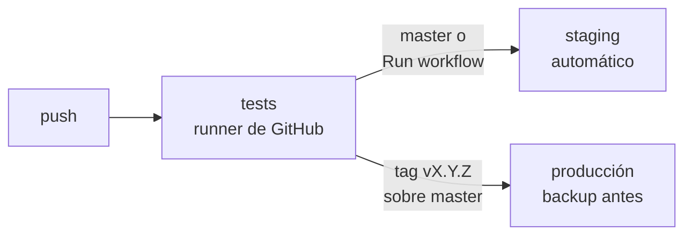

# Despliegue

Posventa corre en el VPS de Crucianelli en dos entornos: **staging** (`staging.portalcrucianelli.site`), para
probar, y **producción** (`odoo.portalcrucianelli.site`). Son dos Odoo separados, con su propia base cada uno. La
configuración del servidor está en el repo privado de infra `ffunes-cru/servidor`: estructura, migración, imagen
de Odoo con rclone, nginx y el script de despliegue.

## Flujo



1. Se trabaja en una branch y se pushea: GitHub corre los tests (`.github/workflows/ci.yml`).
2. Para probar una branch antes de mergearla: *Actions → CI/CD → Run workflow*, elegir la branch. Se despliega en
   staging si pasan los tests.
3. PR a `master`, que está protegida: solo acepta PRs con los tests en verde. Al mergear se despliega en staging.
4. **Producción**: un tag con la versión del manifest sobre un commit de `master`, con o sin el prefijo de Odoo:
   `v1.2.0` o `v19.0.1.2.0` ↔ `19.0.1.2.0`. Se despliega si pasan los tests y el tag coincide con el manifest.

   ```bash
   # 1. Subir la versión en __manifest__.py en la PR; al mergear se despliega en staging
   # 2. Probar en staging; después, el tag sobre ese commit de master
   git tag v1.2.0 && git push origin v1.2.0
   ```

Cada job entra al VPS por SSH con una clave cuyo único comando posible es
`servidor/scripts/desplegar.sh <entorno>` (comando forzado en `authorized_keys`). Le manda `posventa <commit>`.
El script valida el commit (en producción, solo de `master`), hace un backup de la base si es producción, copia
el módulo y lo instala o actualiza. Si falla, restaura la versión anterior.

Las claves, el `known_hosts` y el destino son **secretos** de los environments `staging` y `produccion` de este
repo (`STAGING_SSH_KEY`, `STAGING_KNOWN_HOSTS`, `STAGING_SSH_DESTINO` y los mismos con `PRODUCCION_`). El
environment `produccion` solo acepta tags `v*`. Se cargan con `scripts/configurar_ci.sh` del repo de infra (ver
su README).

## Primera vez en staging

El primer despliegue instala el módulo y crea la base. Después:

1. Entrar con `admin` / `admin` y **cambiar esa contraseña enseguida**.
2. Ajustes → Usuarios: dar a los usuarios de Crucianelli los grupos de Posventa (*Staff* o *Administrador*).
3. Ajustes → Técnico → Servidores de correo saliente, para que lleguen las invitaciones del portal.
4. Posventa → Configuración → Ajustes:
   - Plazos de FRU y FEU (por defecto 10/3 y 20/90 días).
   - Google Drive: seguir [Operación → Google Drive](operacion.md#google-drive) y terminar con *Probar
     conexión*. Mientras no esté configurado, los videos se aceptan igual y esperan en el servidor.
5. Cargar catálogos (sistemas, subsistemas, problemas, tipos de desvío) e importar máquinas desde Excel (ver
   [Operación → Importar máquinas](operacion.md#importar-máquinas-excel)).
6. Crear los concesionarios y darles acceso al portal (ver [Seguridad](seguridad.md)).

## Probar

- [ ] Un concesionario recibe la invitación, entra a `/my/posventa` en el dominio de staging y ve solo sus
      máquinas.
- [ ] Desde el celular, instala el portal como app (ver [Operación → App en el celular](operacion.md#app-en-el-celular))
      y la abre desde el ícono.
- [ ] Crea un reclamo con una foto y un video de más de 20 MB.
- [ ] En el backend, el video pasa de *Sincronizando* a *Disponible* en menos de 5 minutos y el enlace abre el
      archivo en Drive, también desde el portal del concesionario.
- [ ] Con *Probar conexión* fallando (por ejemplo, con un ID de unidad equivocado), un video nuevo se acepta,
      queda *Sincronizando* con el motivo visible, y se sube solo al corregir el ID.
- [ ] El staff toma el reclamo, carga una medida y lo cierra.

## Producción

Posventa ya está instalado en producción, con una versión anterior a la fase 2. Antes de actualizarlo:

1. Restaurar en staging una copia neutralizada de la base de producción. El procedimiento está en el README del
   repo de infra, en *Staging con datos reales*.
2. Desplegar en staging la versión nueva sobre esa copia y recorrer la lista de *Probar*.
3. Recién entonces, pushear el tag de la versión sobre ese commit de `master` (ver *Flujo*).
