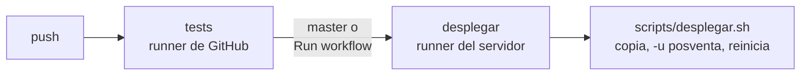

# Despliegue

El servidor corre Odoo 19 con Docker Compose. Cada push corre los tests en GitHub Actions, y lo que llega a
`master` se despliega solo en el servidor de pruebas. Lo mismo se puede hacer a mano con
`scripts/desplegar.sh`.



## 1. Preparar el servidor (una vez)

### Imagen de Odoo con rclone

La imagen oficial `odoo:19.0` no trae rclone, que hace falta para subir los videos a Google Drive.
`docker/Dockerfile` la extiende. En el `docker-compose.yml` del servidor, reemplazar `image: odoo:19.0` por la
construcción de esa imagen:

```yaml
services:
  web:
    build: ./addons/posventa/docker   # en lugar de image: odoo:19.0
    volumes:
      - ./addons:/mnt/extra-addons
      - odoo-data:/var/lib/odoo        # filestore y videos esperando subir a Drive
```

Después: `docker compose build web && docker compose up -d`. La imagen ya trae `openpyxl`, que se usa para
importar máquinas desde Excel.

### Otros requisitos

| Qué | Para qué |
|---|---|
| Disco libre para el volumen de `/var/lib/odoo` | Los videos esperan en `/var/lib/odoo/posventa_staging/` hasta subir a Drive (hasta 1 GB cada uno). |
| Proxy con `client_max_body_size` de 1 MB o más | Cada fragmento de subida mide 768 KB. |
| Servidor de correo saliente (Ajustes → Técnico) | Avisos a concesionarios. |

### Primera instalación del módulo

Copiar la carpeta del módulo a `./addons/posventa` y luego:

```bash
docker compose run --rm web odoo -d <base> -i posventa --stop-after-init
docker compose restart web
```

Después seguir con [Configurar](#4-configurar-primera-vez). Las actualizaciones siguientes las hace el CI/CD.

## 2. Despliegue automático con GitHub Actions

El workflow está en `.github/workflows/ci.yml`:

- **tests:** corre en cada push, en un runner de GitHub, con las imágenes oficiales `odoo:19.0` y
  `postgres:16` y Chrome para los tests de navegador. Instala el módulo en una base vacía y corre sus tests.
- **desplegar:** corre solo si pasaron los tests, en un runner instalado en el servidor de pruebas, en dos
  casos: con cada push a `master`, o a mano desde *Actions → CI/CD → Run workflow* eligiendo cualquier branch.
  Ejecuta `scripts/desplegar.sh`, que:
  1. Copia el módulo a la carpeta de addons.
  2. Detiene el contenedor de Odoo.
  3. Corre `-u posventa`.
  4. Lo vuelve a levantar.
  5. Comprueba que responde.

  Si la actualización falla, restaura el código anterior y levanta Odoo igual. La base no cambia, porque la
  actualización corre en una sola transacción. Odoo queda caído mientras corre `-u posventa`, alrededor de
  medio minuto.

El runner del servidor se conecta a GitHub hacia afuera, así que el servidor no necesita estar expuesto a
internet ni tener SSH abierto.

### Instalar el runner en el servidor

1. Crear un usuario para el runner, con acceso a Docker y permiso de escritura en la carpeta de addons:
   ```bash
   sudo useradd -m github-runner
   sudo usermod -aG docker github-runner
   sudo chown -R github-runner: /ruta/del/compose/addons/posventa   # o la carpeta addons entera
   sudo apt install rsync curl
   ```
   Estar en el grupo `docker` equivale a ser root en ese servidor. Por eso conviene usar un servidor de pruebas
   dedicado.
2. En GitHub, en el repo: *Settings → Actions → Runners → New self-hosted runner → Linux*. Seguir los comandos
   que muestra, como `github-runner`. En `./config.sh` agregar la etiqueta: `--labels posventa-pruebas`.
3. Dejarlo como servicio, para que arranque solo con el servidor:
   ```bash
   sudo ./svc.sh install github-runner && sudo ./svc.sh start
   ```

### Configurar el repo en GitHub

1. *Settings → Environments → New environment*, llamado `pruebas`. Cargar en *Environment variables*:

   | Variable | Ejemplo | Obligatoria |
   |---|---|---|
   | `ODOO_COMPOSE_DIR` | `/opt/odoo` (la carpeta del `docker-compose.yml`) | Sí |
   | `ODOO_DB` | `pruebas` | Sí |
   | `ODOO_ADDONS_DIR` | Por defecto, `$ODOO_COMPOSE_DIR/addons` | No |
   | `ODOO_SERVICE` | Por defecto, `web` | No |
   | `ODOO_URL` | Por defecto, `http://localhost:8069` | No |

2. **Obligatorio, porque el repo es público:** *Settings → Actions → General → Approval for running fork pull
   request workflows from contributors* → **Require approval for all external contributors**. Sin esto, un
   pull request de un desconocido puede modificar el workflow y ejecutar código en el runner del servidor.
3. Opcional: en el environment `pruebas`, *Required reviewers*, para aprobar cada despliegue con un clic.

### Despliegue a mano

Desde una copia del repo en el servidor:

```bash
ODOO_COMPOSE_DIR=/opt/odoo ODOO_DB=pruebas scripts/desplegar.sh
```

## 3. Producción

Usar el mismo workflow con otro runner, con la etiqueta `posventa-produccion` y su propio environment.
Ese environment debería tener *Required reviewers* y dispararse con tags (`v*`) en lugar de push a `master`.
Antes de cada despliegue, sacar un backup de la base. Queda para cuando se pase a producción.

## 4. Configurar (primera vez)

1. Ajustes → Usuarios: dar a los usuarios de Crucianelli los grupos de Posventa (*Staff* o *Administrador*).
2. Posventa → Configuración → Ajustes:
   - Plazos de FRU y FEU (por defecto 10/3 y 20/90 días).
   - Google Drive: seguir [Operación → Google Drive](operacion.md#google-drive) y terminar con *Probar
     conexión*. Mientras no esté configurado, los videos se aceptan igual y esperan en el servidor.
3. Cargar catálogos (sistemas, subsistemas, problemas, tipos de desvío) e importar máquinas desde Excel.
4. Crear los concesionarios y darles acceso al portal (ver [Seguridad](seguridad.md)).

## 5. Probar

- [ ] Un concesionario entra a `/my/posventa` y ve solo sus máquinas.
- [ ] Crea un reclamo con una foto y un video de más de 20 MB.
- [ ] En el backend, el video pasa de *Sincronizando* a *Disponible* en menos de 5 minutos y el enlace abre el
      archivo en Drive, también desde el portal del concesionario.
- [ ] Con *Probar conexión* fallando (por ejemplo, con un ID de unidad equivocado), un video nuevo se acepta,
      queda *Sincronizando* con el motivo visible, y se sube solo al corregir el ID.
- [ ] El staff toma el reclamo, carga una medida y lo cierra.
