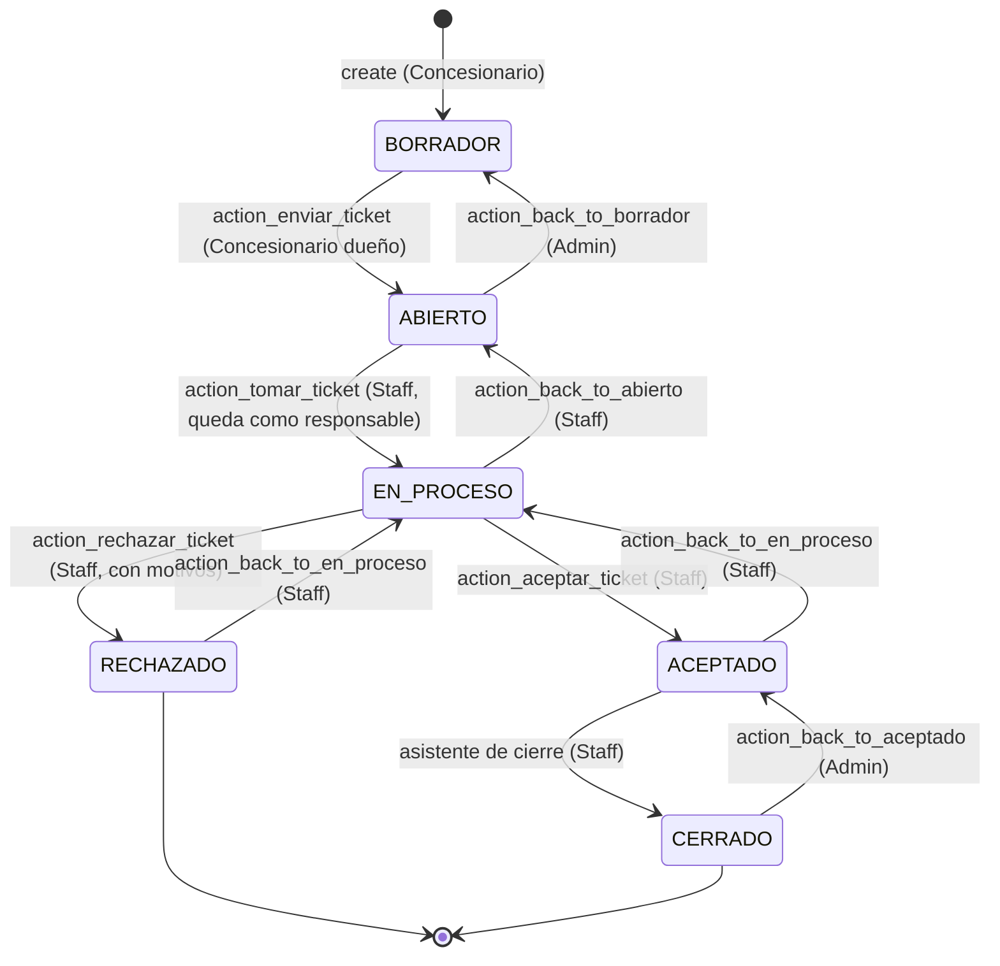
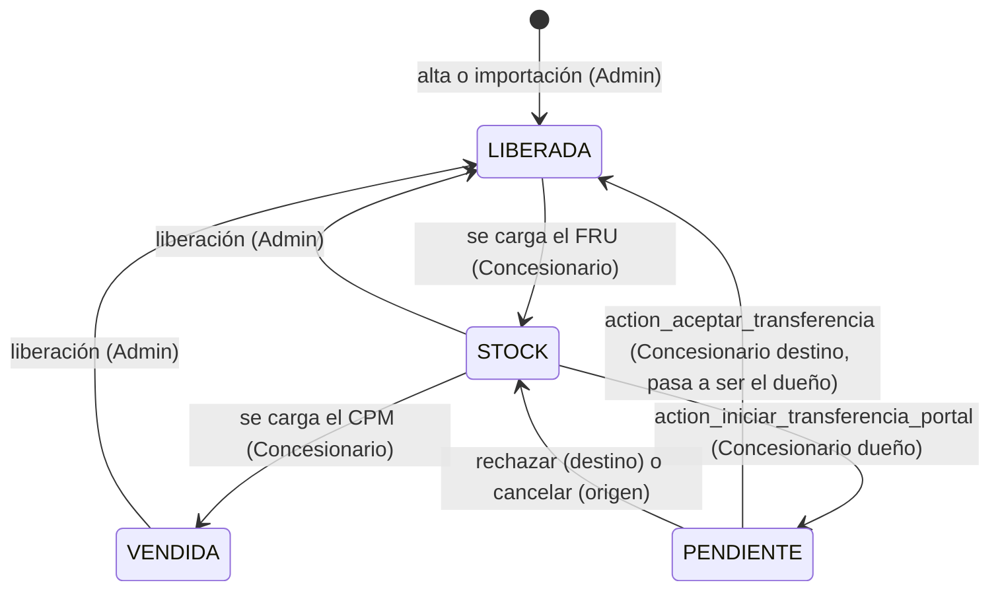
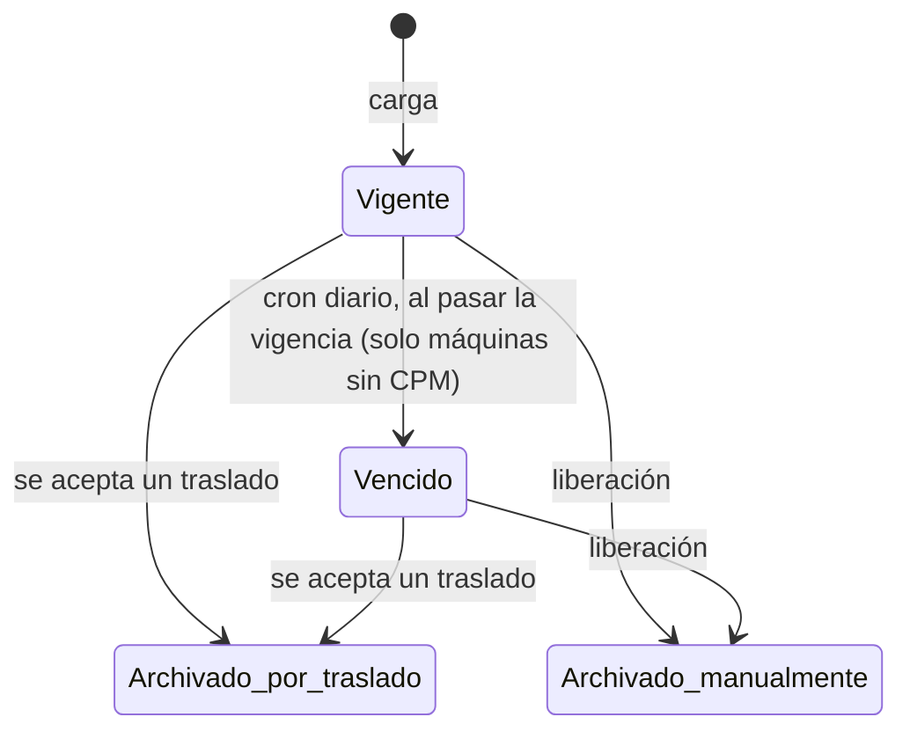

# Flujos y estados

Cada flecha es un método del modelo. El nombre entre paréntesis indica quién puede ejecutarlo; si otro lo
intenta, el método lo rechaza aunque el botón no se vea (ver [Seguridad](seguridad.md)).

## Reclamo (`pv.ticket`)

| Paso | Qué se exige | Qué pasa |
|---|---|---|
| Crear | Máquina en STOCK o VENDIDA, con certificado vigente: CPM en Post-PM; FEU (o FRU) en Pre-PM. Post-PM además pide sistema, subsistema, problema (o "no está en la lista") y hectáreas. | Se numera (secuencia `pv.ticket`) y se asocia al certificado. El tipo Pre/Post-PM se deduce de la máquina. |
| Enviar | Al menos una foto, video o enlace. La máquina y el certificado siguen habilitados. | Correo al Staff (plantilla "ticket creado"). Desde acá el concesionario solo puede agregar archivos. |
| Tomar | — | El Staff queda como responsable. Se registra la primera atención (T1). |
| Aceptar | — | Se registra la solución (T2). Correo al concesionario (plantilla "aceptado"). |
| Rechazar | Al menos un motivo de tipo "Rechazo de reclamo". | Se abre el correo al concesionario con la plantilla "rechazado". Para el concesionario es final: debe crear otro reclamo (el Staff puede reabrirlo si se equivocó). |
| Cerrar | Solución aplicada; si no hay cobertura, sus motivos. | Se guardan garantía, datos SAP y adjunto. Se registra el cierre (T3). |

**Medidas de seguimiento** (`pv.ticket.medida`): el Staff las agrega a un reclamo en curso. Pasan de
*Pendiente* a *En curso* y *Completada*; el cron diario marca *Vencida* la que supera su fecha y lo avisa en el
chatter del reclamo.

## Máquina (`pv.maquina`)

- **No se crean ni envían reclamos** con la máquina LIBERADA o PENDIENTE. Los reclamos ya en curso siguen
  aunque la máquina se traslade o libere.
- **Traslado:** solo desde STOCK. Al aceptarlo, los certificados anteriores pasan a *Archivado por traslado* y
  el nuevo dueño empieza de nuevo con el FRU. Al rechazar o cancelar, la máquina vuelve al estado que le dan
  sus certificados.
- **Liberación (canje / reset):** el concesionario la pide con un motivo desde el portal y el admin la aprueba
  o rechaza; el admin también puede liberar directamente. Los certificados pasan a *Archivado manualmente*.
- Los datos de fábrica (OF, tipo, concesionario, cliente, ubicación) solo los cambia el admin.

## Certificado (`pv.certificado`)

Orden obligatorio y una sola vez cada uno: **FRU → FEU → CPM**. Después del CPM no se cargan más
certificados. El concesionario no puede modificar ni borrar un certificado cargado.

| Tipo | Plazo para cargarlo (desde la liberación) | Vigencia para reclamos (desde su fecha) | Efecto en la máquina |
|---|---|---|---|
| FRU | 10 días (`posventa.fru_expiration_days`) | 3 días (`posventa.fru_grace_days`) | Pasa a STOCK |
| FEU | 20 días (`posventa.feu_expiration_days`) | 90 días (`posventa.feu_claims_validity_days`) | — (habilita el CPM) |
| CPM | — | No vence | Pasa a VENDIDA |

Cargar fuera de plazo se permite, pero queda registrado el retraso en días. Los valores son ajustables en
**Posventa → Configuración → Ajustes**.

El cron diario también avisa al concesionario por correo tres días antes de que venza un certificado.
