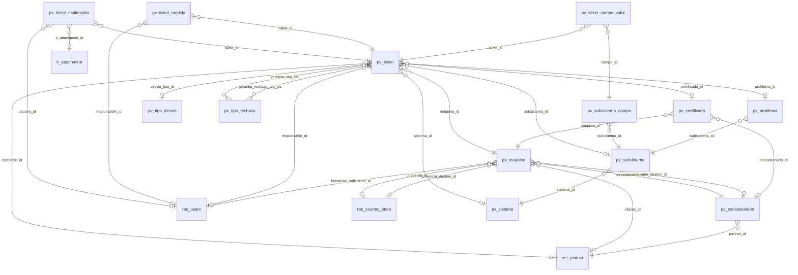

# Referencia generada del módulo Posventa

> Archivo generado por `tools/documentacion.py`: no editar a mano. Cómo regenerarlo: ver el encabezado de ese archivo.

## Diagrama de datos

## Modelos y campos

### `pv.certificado` — Certificado de Máquina
| Campo | Tipo | Etiqueta | Detalle |
|---|---|---|---|
| `active` | boolean | Activo |  |
| `archivo` | binary | Archivo PDF | obligatorio |
| `archivo_nombre` | char | Nombre de archivo | obligatorio |
| `concesionario_id` | many2one | Concesionario Emisor | → `pv.concesionario` |
| `dias_para_vencer` | integer | Días para Vencer | calculado |
| `dias_retraso_carga` | integer | Días de Retraso en Carga | calculado (guardado); Días que la carga real superó el plazo nominal. |
| `estado_certificado` | selection | Estado / Tag | valores: `vigente`, `vencido`, `archivado_traslado`, `archivado_manual`, `legacy`; obligatorio |
| `fecha` | date | Fecha | obligatorio |
| `fecha_limite_carga` | date | Plazo Nominal de Carga | calculado (guardado); Fecha límite nominal que tenía la máquina para la carga de este certificado. |
| `fecha_vencimiento` | date | Vigente para Reclamos hasta | calculado (guardado); Hasta esta fecha el certificado permite crear reclamos; después pasa a Vencido. El CPM no vence. |
| `maquina_id` | many2one | Máquina | → `pv.maquina`; obligatorio |
| `name` | char | Referencia | calculado (guardado) |
| `notas` | text | Observaciones |  |
| `ticket_count` | integer | Cantidad de Tickets | calculado |
| `ticket_ids` | one2many | Tickets / Reclamos | → `pv.ticket` |
| `tipo` | selection | Tipo | valores: `cpm`, `fru`, `feu`, `informe_servicio`, `recall`; obligatorio |

### `pv.concesionario` — Concesionario
| Campo | Tipo | Etiqueta | Detalle |
|---|---|---|---|
| `active` | boolean | Active |  |
| `city` | char | Ciudad | related `p.a.r.t.n.e.r._.i.d...c.i.t.y` |
| `contacto_partner_ids` | one2many | Contactos / Personal de la Empresa | → `res.partner`; related `p.a.r.t.n.e.r._.i.d...c.h.i.l.d._.i.d.s` |
| `email` | char | Email | related `p.a.r.t.n.e.r._.i.d...e.m.a.i.l` |
| `maquina_count` | integer | Cant. Máquinas | calculado |
| `maquina_ids` | one2many | Máquinas | → `pv.maquina` |
| `name` | char | Nombre | obligatorio |
| `partner_id` | many2one | Empresa Concesionario | → `res.partner`; obligatorio; Empresa vinculada. Sus contactos con acceso al portal operan en nombre del concesionario. |
| `phone` | char | Teléfono | related `p.a.r.t.n.e.r._.i.d...p.h.o.n.e` |
| `state_id` | many2one | Provincia | → `res.country.state`; related `p.a.r.t.n.e.r._.i.d...s.t.a.t.e._.i.d` |
| `ticket_count` | integer | Cant. Tickets | calculado |

### `pv.maquina` — Máquina Posventa
| Campo | Tipo | Etiqueta | Detalle |
|---|---|---|---|
| `active` | boolean | Active |  |
| `certificado_count` | integer | Certificado Count | calculado |
| `certificado_ids` | one2many | Certificados | → `pv.certificado` |
| `ciudad` | char | Ciudad |  |
| `ciudad_destino` | char | Ciudad Destino |  |
| `cliente_id` | many2one | Cliente | → `res.partner` |
| `cliente_nombre` | char | Nombre del Cliente | related `c.l.i.e.n.t.e._.i.d...n.a.m.e` |
| `concesionario_destino_id` | many2one | Concesionario Destino | → `pv.concesionario` |
| `concesionario_id` | many2one | Concesionario | → `pv.concesionario`; obligatorio |
| `es_concesionario_destino` | boolean | Es Concesionario Destino | calculado |
| `estado` | selection | Estado | valores: `pendiente`, `liberada`, `stock`, `vendida`; obligatorio |
| `fecha_liberacion` | date | Fecha de Liberación / Inicio Plazo | Fecha en la que la máquina fue liberada o transferida, base para cálculo de vencimientos de certificados. |
| `fecha_venta` | datetime | Fecha de Venta | Fecha en la que la máquina pasó a estado VENDIDA |
| `is_pv_admin` | boolean | Is Pv Admin | calculado |
| `liberacion_fecha_solicitud` | datetime | Fecha de Solicitud de Liberación |  |
| `liberacion_motivo` | text | Motivo de Liberación |  |
| `liberacion_solicitada` | boolean | Liberación Solicitada |  |
| `liberacion_solicitante_id` | many2one | Liberación Solicitada por | → `res.users` |
| `name` | char | Referencia | calculado (guardado) |
| `of` | char | Orden de Fabricación | obligatorio |
| `provincia_destino_id` | many2one | Provincia Destino | → `res.country.state` |
| `provincia_id` | many2one | Provincia | → `res.country.state` |
| `ticket_count` | integer | Ticket Count | calculado |
| `ticket_ids` | one2many | Tickets | → `pv.ticket` |
| `tiene_cpm` | boolean | Tiene CPM | calculado (guardado) |
| `tiene_feu` | boolean | Tiene FEU | calculado (guardado) |
| `tiene_feu_vigente` | boolean | Tiene FEU Vigente | calculado (guardado) |
| `tiene_fru` | boolean | Tiene FRU | calculado (guardado) |
| `tipo` | selection | Tipo de Máquina | valores: `pionera`, `gringa`, `drilor`, `plantor`, `mixia`; obligatorio |

### `pv.problema` — Problema / Código de Falla
| Campo | Tipo | Etiqueta | Detalle |
|---|---|---|---|
| `active` | boolean | Active |  |
| `codigo` | char | Código de falla |  |
| `name` | char | Descripción | obligatorio |
| `sistema_id` | many2one | Sistema | → `pv.sistema`; related `s.u.b.s.i.s.t.e.m.a._.i.d...s.i.s.t.e.m.a._.i.d` |
| `subsistema_id` | many2one | Subsistema | → `pv.subsistema`; obligatorio |

### `pv.sistema` — Sistema Involucrado
| Campo | Tipo | Etiqueta | Detalle |
|---|---|---|---|
| `active` | boolean | Active |  |
| `codigo` | char | Código |  |
| `name` | char | Nombre | obligatorio |
| `sequence` | integer | Secuencia |  |
| `subsistema_ids` | one2many | Subsistemas | → `pv.subsistema` |

### `pv.subsistema` — Subsistema
| Campo | Tipo | Etiqueta | Detalle |
|---|---|---|---|
| `active` | boolean | Active |  |
| `campo_extra_ids` | one2many | Campos adicionales | → `pv.subsistema.campo`; Campos de información adicional que se solicitan al concesionario al seleccionar este subsistema |
| `codigo` | char | Código |  |
| `name` | char | Nombre | obligatorio |
| `placeholder_descripcion` | text | Guía para descripción | Texto de ayuda que se muestra al concesionario para guiar la descripción del problema |
| `problema_ids` | one2many | Problemas | → `pv.problema` |
| `sequence` | integer | Secuencia |  |
| `sistema_id` | many2one | Sistema | → `pv.sistema`; obligatorio |

### `pv.subsistema.campo` — Campo Adicional de Subsistema
| Campo | Tipo | Etiqueta | Detalle |
|---|---|---|---|
| `name` | char | Etiqueta | obligatorio |
| `obligatorio` | boolean | Obligatorio |  |
| `opciones` | text | Opciones | Opciones separadas por \| (solo para tipo Selección). Ej: Opción A\|Opción B\|Opción C |
| `sequence` | integer | Secuencia |  |
| `subsistema_id` | many2one | Subsistema | → `pv.subsistema`; obligatorio |
| `tipo_campo` | selection | Tipo de campo | valores: `texto`, `numero`, `seleccion`, `booleano`; obligatorio |

### `pv.ticket` — Ticket de Reclamo Posventa
| Campo | Tipo | Etiqueta | Detalle |
|---|---|---|---|
| `acciones_realizadas` | text | Acciones realizadas |  |
| `campo_extra_ids` | one2many | Información adicional | → `pv.ticket.campo.valor` |
| `certificado_id` | many2one | Certificado Asociado | → `pv.certificado`; calculado (guardado); Certificado vigente asociado al momento de la creación del ticket. |
| `cliente_id` | many2one | Cliente | → `res.partner`; related `m.a.q.u.i.n.a._.i.d...c.l.i.e.n.t.e._.i.d` |
| `color` | integer | Color |  |
| `concesionario_id` | many2one | Concesionario | → `pv.concesionario`; related `m.a.q.u.i.n.a._.i.d...c.o.n.c.e.s.i.o.n.a.r.i.o._.i.d` |
| `descripcion` | text | Descripción del reclamo |  |
| `desvio_tipo_id` | many2one | Tipo de Desvío | → `pv.tipo.desvio` |
| `drive_folder_url` | char | Carpeta en Google Drive |  |
| `estado` | selection | Estado | valores: `borrador`, `abierto`, `en_proceso`, `aceptado`, `rechazado`, `cerrado`; obligatorio |
| `fecha_cierre` | datetime | Fecha de cierre |  |
| `fecha_creacion` | datetime | Fecha de creación |  |
| `fecha_primera_atencion` | datetime | Primera atención |  |
| `fecha_solucion` | datetime | Fecha de solución |  |
| `garantia_aceptada` | boolean | Garantía Aceptada |  |
| `garantia_adjunto` | binary | Adjunto de Garantía |  |
| `garantia_adjunto_name` | char | Nombre del adjunto de garantía |  |
| `garantia_observaciones` | text | Observaciones de Garantía |  |
| `garantia_rechazo_tag_ids` | many2many | Motivos sin Cobertura | → `pv.tipo.rechazo`; Motivos por los que la garantía no cubre la pieza (la abona el concesionario/cliente). |
| `hectareas` | float | Hectáreas | Hectáreas trabajadas por la máquina al momento de la falla (obligatorio en reclamos Post-PM). |
| `maquina_id` | many2one | Máquina | → `pv.maquina`; obligatorio |
| `medida_count` | integer | Medida Count | calculado (guardado) |
| `medida_ids` | one2many | Medidas / Seguimiento | → `pv.ticket.medida` |
| `medidas_vencidas_count` | integer | Medidas Vencidas Count | calculado (guardado) |
| `multimedia_count` | integer | Cantidad de Archivos Multimedia | calculado |
| `multimedia_ids` | one2many | Archivos Multimedia Pesados | → `pv.ticket.multimedia` |
| `multimedia_url` | char | Multimedia (link Google Drive) |  |
| `name` | char | Número |  |
| `of` | char | Orden de Fabricación | related `m.a.q.u.i.n.a._.i.d...o.f` |
| `operador_id` | many2one | Cargado por | → `res.partner` |
| `operador_nombre` | char | Nombre del Operador | related `o.p.e.r.a.d.o.r._.i.d...n.a.m.e` |
| `placeholder_descripcion` | text | Guía para descripción | related `s.u.b.s.i.s.t.e.m.a._.i.d...p.l.a.c.e.h.o.l.d.e.r._.d.e.s.c.r.i.p.c.i.o.n`; Texto de ayuda que se muestra al concesionario para guiar la descripción del problema |
| `prioridad` | selection | Prioridad | valores: `baja`, `media`, `alta`, `critica` |
| `problema_id` | many2one | Problema | → `pv.problema` |
| `problema_no_listado` | boolean | Problema no listado | El problema no figura en el catálogo del subsistema; se detalla en la descripción. |
| `rechazo_tag_ids` | many2many | Motivos de Rechazo del Reclamo | → `pv.tipo.rechazo`; Errores de carga por los que se rechaza el reclamo. El concesionario debe crear un ticket nuevo. |
| `responsable_id` | many2one | Responsable | → `res.users` |
| `responsable_nombre` | char | Nombre del Responsable | related `r.e.s.p.o.n.s.a.b.l.e._.i.d...n.a.m.e` |
| `sap_centro` | char | Centro SAP |  |
| `sap_material` | char | Material SAP |  |
| `sap_notas` | text | Notas SAP |  |
| `sap_numero_aviso` | char | Nro. Aviso SAP |  |
| `sap_numero_orden` | char | Nro. Orden SAP |  |
| `sap_numero_pedido` | char | Nro. Pedido SAP | Número de pedido registrado en SAP para repuestos o insumos. |
| `sistema_id` | many2one | Sistema involucrado | → `pv.sistema` |
| `solucion_aplicada` | text | Solución Aplicada | Qué se hizo para resolver la falla. Se carga al cerrar y alimenta el historial de casos similares. |
| `storage_mode` | selection | Modo de Almacenamiento | valores: `drive`, `odoo`; calculado |
| `subsistema_id` | many2one | Subsistema | → `pv.subsistema` |
| `t1_horas` | float | T1 (horas) | calculado (guardado); Tiempo de primera atención: desde creación hasta primera asignación |
| `t2_horas` | float | T2 (horas) | calculado (guardado); Tiempo de solución: desde creación hasta contención/solución |
| `t3_horas` | float | T3 (horas) | calculado (guardado); Tiempo de cierre definitivo: desde creación hasta cierre (interno) |
| `tipo_garantia` | selection | Tipo de Garantía | valores: `tecnica`, `comercial` |
| `tipo_maquina` | selection | Tipo de Máquina | related `m.a.q.u.i.n.a._.i.d...t.i.p.o` |
| `tipo_ticket` | selection | Tipo de Ticket | valores: `pre_pm`, `post_pm`; calculado (guardado) |
| `ubicacion_actual` | char | Ubicación actual |  |

### `pv.ticket.campo.valor` — Valor de Campo Adicional en Ticket
| Campo | Tipo | Etiqueta | Detalle |
|---|---|---|---|
| `campo_id` | many2one | Campo | → `pv.subsistema.campo`; obligatorio |
| `campo_nombre` | char | Etiqueta | related `c.a.m.p.o._.i.d...n.a.m.e` |
| `campo_obligatorio` | boolean | Obligatorio | related `c.a.m.p.o._.i.d...o.b.l.i.g.a.t.o.r.i.o` |
| `campo_opciones` | text | Opciones | related `c.a.m.p.o._.i.d...o.p.c.i.o.n.e.s`; Opciones separadas por \| (solo para tipo Selección). Ej: Opción A\|Opción B\|Opción C |
| `campo_sequence` | integer | Secuencia | related `c.a.m.p.o._.i.d...s.e.q.u.e.n.c.e` |
| `campo_tipo` | selection | Tipo | related `c.a.m.p.o._.i.d...t.i.p.o._.c.a.m.p.o` |
| `ticket_id` | many2one | Ticket | → `pv.ticket`; obligatorio |
| `valor` | char | Valor |  |

### `pv.ticket.medida` — Medida / Seguimiento de Ticket
| Campo | Tipo | Etiqueta | Detalle |
|---|---|---|---|
| `comentario` | text | Comentario |  |
| `concesionario_id` | many2one | Concesionario | → `pv.concesionario`; related `t.i.c.k.e.t._.i.d...c.o.n.c.e.s.i.o.n.a.r.i.o._.i.d` |
| `estado` | selection | Estado | valores: `pendiente`, `en_curso`, `completada`, `vencida`; obligatorio |
| `fecha_completada` | datetime | Fecha completada |  |
| `fecha_creacion` | datetime | Fecha de creación |  |
| `fecha_vencimiento` | date | Fecha de vencimiento |  |
| `name` | char | Título | obligatorio |
| `responsable_id` | many2one | Responsable | → `res.users` |
| `ticket_estado` | selection | Estado del Ticket | related `t.i.c.k.e.t._.i.d...e.s.t.a.d.o` |
| `ticket_id` | many2one | Ticket | → `pv.ticket`; obligatorio |
| `ticket_name` | char | Nro. Ticket | related `t.i.c.k.e.t._.i.d...n.a.m.e` |
| `tipo` | selection | Tipo | valores: `accion`, `medida`, `actualizacion`, `resolucion_parcial`, `resolucion_definitiva`; obligatorio |

### `pv.ticket.multimedia` — Archivo Multimedia Pesado de Ticket (Google Drive)
| Campo | Tipo | Etiqueta | Detalle |
|---|---|---|---|
| `drive_folder_url` | char | Carpeta en Drive |  |
| `drive_url` | char | Enlace Google Drive |  |
| `error_message` | text | Detalle de Error |  |
| `estado_sync` | selection | Estado de Sincronización | valores: `procesando`, `disponible`, `error`; obligatorio |
| `file_size` | integer | Tamaño (Bytes) |  |
| `file_size_display` | char | Tamaño | calculado (guardado) |
| `ir_attachment_id` | many2one | Adjunto Odoo | → `ir.attachment` |
| `is_video` | boolean | Es Video | calculado (guardado) |
| `mimetype` | char | Tipo MIME |  |
| `name` | char | Nombre de Archivo | obligatorio |
| `staging_path` | char | Ruta Temporal Staging |  |
| `sync_intentos` | integer | Intentos de Sincronización |  |
| `sync_proximo_intento` | datetime | Próximo Reintento |  |
| `ticket_id` | many2one | Ticket de Reclamo | → `pv.ticket`; obligatorio |
| `usuario_id` | many2one | Cargado por | → `res.users` |

### `pv.tipo.desvio` — Tipo de Desvío de Reclamo
| Campo | Tipo | Etiqueta | Detalle |
|---|---|---|---|
| `active` | boolean | Activo |  |
| `codigo` | char | Código | Identificador técnico o código SAP (opcional) |
| `name` | char | Nombre | obligatorio |
| `sequence` | integer | Secuencia |  |

### `pv.tipo.rechazo` — Tipo / Motivo de Rechazo de Reclamo o Garantía
| Campo | Tipo | Etiqueta | Detalle |
|---|---|---|---|
| `active` | boolean | Activo |  |
| `aplica_a` | selection | Aplica a | valores: `reclamo`, `garantia`; obligatorio; Rechazo de Reclamo: el concesionario cargó el reclamo de forma incorrecta (debe crear uno nuevo). Sin Cobertura de Garantía: el reclamo era válido pero la pieza no está cubierta y la abona el concesionario/cliente. |
| `color` | integer | Color de Etiqueta |  |
| `descripcion` | text | Descripción / Criterio |  |
| `name` | char | Motivo / Tag | obligatorio |
| `sequence` | integer | Secuencia |  |

## Puntos de entrada

Métodos públicos (invocables por RPC) de modelos y asistentes, y quién los llama. Las llamadas desde Python se buscan por nombre en `controllers/` y `wizard/`, así que un nombre repetido en otro modelo puede aparecer de más.

| Modelo | Método | Qué hace | Llamado desde |
|---|---|---|---|
| `pv.cerrar.ticket.wizard` | `action_confirmar` |  | botón en vista `pv.cerrar.ticket.wizard.view.form` |
| `pv.certificado` | `_archive_expired_certificates` | Cron diario: pasa a Vencido los certificados cuya vigencia para reclamos expiró (no aplica al CPM). | cron «Posventa: Archivar vencimientos de certificados» |
| `pv.certificado` | `_notify_upcoming_certificate_expiration` | Cron diario: avisa al concesionario 3 días antes de que venza un certificado. | cron «Posventa: Notificar vencimientos próximos de certificados» |
| `pv.certificado` | `action_view_tickets` |  | botón en vista `pv.certificado.view.form` |
| `pv.certificado` | `get_portal_list_data` | Certificados visibles por el usuario para el listado del portal. | `controllers/portal.py` |
| `pv.concesionario` | `action_gestionar_acceso_portal` | Asistente estándar de acceso al portal para los contactos de la empresa. | botón en vista `pv.concesionario.view.form` |
| `pv.concesionario` | `action_view_maquinas` |  | botón en vista `pv.concesionario.view.form` |
| `pv.concesionario` | `action_view_tickets` |  | botón en vista `pv.concesionario.view.form` |
| `pv.dashboard` | `action_open_dashboard` |  | acción de servidor «Tablero de Control» |
| `pv.dashboard` | `action_view_metrics` |  | botón en vista `pv.dashboard.view.form` |
| `pv.dashboard` | `action_view_tickets` | Listado de tickets del estado indicado en el contexto del botón. | botón en vista `pv.dashboard.view.form` |
| `pv.import.maquinas` | `action_import` | Crea las filas válidas; las que tienen errores se omiten (ya se mostraron en la vista previa). | botón en vista `pv.import.maquinas.form` |
| `pv.import.maquinas` | `action_preview` |  | botón en vista `pv.import.maquinas.form` |
| `pv.liberar.maquina.wizard` | `action_liberar` |  | botón en vista `pv.liberar.maquina.wizard.view.form` |
| `pv.maquina` | `action_abrir_wizard_liberacion` |  | botón en vista `pv.maquina.view.form` |
| `pv.maquina` | `action_abrir_wizard_transferencia` |  | botón en vista `pv.maquina.view.form` |
| `pv.maquina` | `action_aceptar_transferencia` | El destino acepta: la máquina pasa a él como LIBERADA y se archivan los certificados anteriores. | botón en vista `pv.maquina.view.form` |
| `pv.maquina` | `action_aprobar_liberacion` |  | botón en vista `pv.maquina.view.form` |
| `pv.maquina` | `action_cancelar_transferencia` | El concesionario de origen (o admin) cancela una propuesta de traslado pendiente. | botón en vista `pv.maquina.view.form` |
| `pv.maquina` | `action_iniciar_transferencia_portal` |  | `controllers/portal.py` |
| `pv.maquina` | `action_liberar_maquina` | Liberación directa por el admin (canje / reset), con motivo obligatorio. | `wizard/pv_liberar_maquina_wizard.py` |
| `pv.maquina` | `action_rechazar_liberacion` |  | botón en vista `pv.maquina.view.form` |
| `pv.maquina` | `action_rechazar_transferencia` |  | botón en vista `pv.maquina.view.form` |
| `pv.maquina` | `action_solicitar_liberacion` | El concesionario dueño solicita liberar la máquina; la liberación la aprueba el admin. | `controllers/portal.py` |
| `pv.maquina` | `action_view_certificados` |  | botón en vista `pv.maquina.view.form` |
| `pv.maquina` | `action_view_tickets` |  | botón en vista `pv.maquina.view.form` |
| `pv.maquina` | `get_portal_detail_data` | Datos de la máquina para el portal web y sus asistentes OWL. | JS `static/src/frontend/portal_posventa.js`; `controllers/portal.py` |
| `pv.maquina` | `get_transfer_catalog_data` | Concesionarios y provincias para el formulario de traslado. | `controllers/portal.py` |
| `pv.ticket` | `action_abrir_carpeta_drive` | Abre la carpeta de Google Drive del ticket o, si no hay, el primer enlace multimedia disponible. | botón en vista `pv.ticket.view.form` |
| `pv.ticket` | `action_aceptar_ticket` | Acepta el reclamo (EN PROCESO -> ACEPTADO): es válido y queda en evaluación de garantía. | botón en vista `pv.ticket.view.form` |
| `pv.ticket` | `action_adjuntar_multimedia` | Abre el asistente para adjuntar un archivo multimedia o enlace de Google Drive. | botón en vista `pv.ticket.view.form` |
| `pv.ticket` | `action_back_to_abierto` |  | botón en vista `pv.ticket.view.form` |
| `pv.ticket` | `action_back_to_aceptado` |  | botón en vista `pv.ticket.view.form` |
| `pv.ticket` | `action_back_to_borrador` |  | botón en vista `pv.ticket.view.form` |
| `pv.ticket` | `action_back_to_en_proceso` |  | botón en vista `pv.ticket.view.form` |
| `pv.ticket` | `action_cerrar_ticket` | Abre el asistente de cierre (ACEPTADO -> CERRADO): solución aplicada, cobertura de garantía y datos SAP. | botón en vista `pv.ticket.view.form` |
| `pv.ticket` | `action_enviar_ticket` | El concesionario envía el ticket al Staff (BORRADOR -> ABIERTO). | JS `static/src/frontend/wizards/ticket_wizard.js`; botón en vista `pv.ticket.view.form` |
| `pv.ticket` | `action_rechazar_ticket` | Rechaza el reclamo por error de carga (EN PROCESO -> RECHAZADO) y abre el correo al concesionario. | botón en vista `pv.ticket.view.form` |
| `pv.ticket` | `action_tomar_ticket` | El Staff toma el ticket (ABIERTO -> EN PROCESO) y queda como responsable. | botón en vista `pv.ticket.view.form` |
| `pv.ticket` | `action_view_medidas` |  | botón en vista `pv.ticket.view.form` |
| `pv.ticket` | `get_wizard_catalog_data` | Catálogo para el asistente de reclamo: desplegables en cascada, campos adicionales y límites de subida. | JS `static/src/frontend/wizards/ticket_wizard.js` |
| `pv.ticket` | `portal_adjuntar_archivo` | Adjunta una foto/archivo chico al ticket (los usuarios portal no crean ir.attachment directamente). | JS `static/src/shared/chunk_upload.js` |
| `pv.ticket.medida` | `_cron_check_vencimientos` | Cron job: mark overdue measures and notify. | cron «Posventa: Verificar vencimientos de medidas» |
| `pv.ticket.medida` | `action_completar` |  | botón en vista `pv.ticket.medida.view.form`; botón en vista `pv.ticket.medida.view.tree` |
| `pv.ticket.medida` | `action_en_curso` |  | botón en vista `pv.ticket.medida.view.form` |
| `pv.ticket.multimedia` | `_cron_sync_pending` | Sincroniza a Drive los archivos encolados o con error recuperable (uno por commit). | cron «Posventa: Sincronizar multimedia pendiente a Google Drive» |
| `pv.ticket.multimedia` | `action_abrir_drive` |  | botón en vista `pv.ticket.multimedia.view.form`; botón en vista `pv.ticket.view.form` |
| `pv.ticket.multimedia` | `action_reintentar_sync` | Reencola la sincronización (reinicia el contador de reintentos automáticos). | botón en vista `pv.ticket.multimedia.view.form`; botón en vista `pv.ticket.view.form` |
| `pv.ticket.multimedia` | `get_upload_config` | Límites y destino de subida que usan los asistentes JS (portal y backend). | JS `static/src/backend/multimedia_chunk_uploader.js`; JS `static/src/frontend/portal_posventa.js` |
| `pv.ticket.multimedia.wizard` | `action_adjuntar` |  | botón en vista `pv.ticket.multimedia.wizard.form` |
| `pv.transferir.maquina.wizard` | `action_transferir` |  | botón en vista `pv.transferir.maquina.wizard.form` |

## Permisos por modelo

L = leer, E = escribir, C = crear, B = borrar. Sin fila: el grupo no accede al modelo.

| Modelo | Grupo | Permisos |
|---|---|---|
| `pv.cerrar.ticket.wizard` | Staff Call Center | `LECB` |
| `pv.certificado` | Administrador Posventa | `LECB` |
| `pv.certificado` | Concesionario | `L-C-` |
| `pv.certificado` | Staff Call Center | `LE--` |
| `pv.concesionario` | Administrador Posventa | `LECB` |
| `pv.concesionario` | Concesionario | `L---` |
| `pv.concesionario` | Staff Call Center | `L---` |
| `pv.dashboard` | Staff Call Center | `LECB` |
| `pv.import.maquinas` | Administrador Posventa | `LECB` |
| `pv.liberar.maquina.wizard` | Administrador Posventa | `LECB` |
| `pv.maquina` | Administrador Posventa | `LECB` |
| `pv.maquina` | Concesionario | `L---` |
| `pv.maquina` | Staff Call Center | `L---` |
| `pv.problema` | Administrador Posventa | `LECB` |
| `pv.problema` | Concesionario | `L---` |
| `pv.problema` | Staff Call Center | `L---` |
| `pv.sistema` | Administrador Posventa | `LECB` |
| `pv.sistema` | Concesionario | `L---` |
| `pv.sistema` | Staff Call Center | `L---` |
| `pv.subsistema` | Administrador Posventa | `LECB` |
| `pv.subsistema` | Concesionario | `L---` |
| `pv.subsistema` | Staff Call Center | `L---` |
| `pv.subsistema.campo` | Administrador Posventa | `LECB` |
| `pv.subsistema.campo` | Concesionario | `L---` |
| `pv.subsistema.campo` | Staff Call Center | `L---` |
| `pv.ticket` | Administrador Posventa | `LECB` |
| `pv.ticket` | Concesionario | `LEC-` |
| `pv.ticket` | Staff Call Center | `LEC-` |
| `pv.ticket.campo.valor` | Concesionario | `LEC-` |
| `pv.ticket.campo.valor` | Staff Call Center | `LECB` |
| `pv.ticket.medida` | Concesionario | `L---` |
| `pv.ticket.medida` | Staff Call Center | `LECB` |
| `pv.ticket.multimedia` | Concesionario | `L---` |
| `pv.ticket.multimedia` | Staff Call Center | `LECB` |
| `pv.ticket.multimedia.wizard` | Staff Call Center | `LECB` |
| `pv.tipo.desvio` | Administrador Posventa | `LECB` |
| `pv.tipo.desvio` | Concesionario | `L---` |
| `pv.tipo.desvio` | Staff Call Center | `L---` |
| `pv.tipo.rechazo` | Administrador Posventa | `LECB` |
| `pv.tipo.rechazo` | Concesionario | `L---` |
| `pv.tipo.rechazo` | Staff Call Center | `L---` |
| `pv.transferir.maquina.wizard` | Administrador Posventa | `LECB` |

## Reglas de registro

Filtran qué registros ve cada grupo. Las reglas de distintos grupos de un mismo usuario se suman (O lógico).

| Modelo | Grupos | Regla | Dominio |
|---|---|---|---|
| `pv.certificado` | Concesionario | Certificados: emitidos por el concesionario o de sus máquinas actuales | `['\|', ('concesionario_id.partner_id', 'in', [user.partner_id.id, user.partner_id.commercial_partner_id.id]), ('maquina_id.concesionario_id.partner_id', 'in', [user.partner_id.id, user.partner_id.commercial_partner_id.id])]` |
| `pv.certificado` | Staff Call Center | Certificados: todos (Staff) | `[(1, '=', 1)]` |
| `pv.maquina` | Concesionario | Máquinas: propias o con traslado pendiente hacia el concesionario | `['\|', ('concesionario_id.partner_id', 'in', [user.partner_id.id, user.partner_id.commercial_partner_id.id]), '&', ('estado', '=', 'pendiente'), ('concesionario_destino_id.partner_id', 'in', [user.partner_id.id, user.partner_id.commercial_partner_id.id])]` |
| `pv.maquina` | Staff Call Center | Máquinas: todas (Staff) | `[(1, '=', 1)]` |
| `pv.ticket` | Concesionario | Tickets: solo propios (Concesionario) | `[('concesionario_id.partner_id', 'in', [user.partner_id.id, user.partner_id.commercial_partner_id.id])]` |
| `pv.ticket` | Staff Call Center | Tickets: todos no borradores (Staff) | `[('estado', '!=', 'borrador')]` |
| `pv.ticket` | Administrador Posventa | Tickets: todos sin restricción (Admin) | `[(1, '=', 1)]` |
| `pv.ticket.campo.valor` | Concesionario | Campos adicionales: solo de tickets propios (Concesionario) | `[('ticket_id.concesionario_id.partner_id', 'in', [user.partner_id.id, user.partner_id.commercial_partner_id.id])]` |
| `pv.ticket.campo.valor` | Staff Call Center | Campos adicionales: todos (Staff) | `[(1, '=', 1)]` |
| `pv.ticket.medida` | Concesionario | Medidas: solo de tickets propios (Concesionario) | `[('ticket_id.concesionario_id.partner_id', 'in', [user.partner_id.id, user.partner_id.commercial_partner_id.id])]` |
| `pv.ticket.medida` | Staff Call Center | Medidas: todos (Staff) | `[(1, '=', 1)]` |
| `pv.ticket.multimedia` | Concesionario | Multimedia: solo de tickets propios (Concesionario) | `[('ticket_id.concesionario_id.partner_id', 'in', [user.partner_id.id, user.partner_id.commercial_partner_id.id])]` |
| `pv.ticket.multimedia` | Staff Call Center | Multimedia: todos (Staff) | `[(1, '=', 1)]` |
