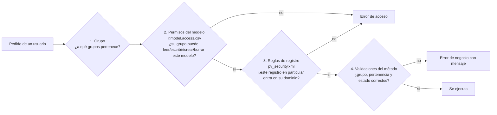

# Seguridad

Odoo controla el acceso en tres capas. Para entender cualquier "no tiene acceso" hay que mirar las tres:



La capa 4 es propia de este módulo: cada `action_*` vuelve a validar, por si alguien llama al método sin
pasar por la pantalla.

## Grupos

| Grupo (`posventa.`) | Tipo de usuario | Hereda |
|---|---|---|
| `group_pv_concesionario` — Concesionario | Portal | — |
| `group_pv_staff` — Staff Call Center | Interno | — |
| `group_pv_admin` — Administrador Posventa | Interno | Staff y "Administrar contactos" |

La tabla completa de permisos por modelo y de reglas está en la [referencia generada](referencia.md#permisos-por-modelo).

## Pertenencia a un concesionario

Un usuario pertenece a un concesionario si su contacto **es** la empresa del concesionario o **es un contacto
de esa empresa** (campo *Empresa* del contacto). Está definido en un solo lugar en Python,
`pv.concesionario._get_by_contact()`, y repetido en el dominio de cada regla de `security/pv_security.xml`:

```python
[('concesionario_id.partner_id', 'in', [user.partner_id.id, user.partner_id.commercial_partner_id.id])]
```

Si se cambia uno, hay que cambiar el otro.

**Dar acceso a un empleado del concesionario:** en el backend, abrir el concesionario → botón *Gestionar acceso
al portal* → marcar el contacto → *Otorgar acceso*. El contacto recibe el correo de invitación y queda en los
grupos Portal y Concesionario (`wizard/portal_wizard.py`). Si la persona no figura, primero crearla como
contacto de la empresa del concesionario.

## Lo que ve cada uno

| | Concesionario | Staff | Admin |
|---|---|---|---|
| Máquinas | Las suyas y las que le proponen trasladar | Todas | Todas |
| Certificados | Los que cargó y los de sus máquinas actuales | Todos | Todos |
| Reclamos | Los suyos, en cualquier estado | Todos menos los borradores | Todos |
| Medidas, archivos, campos adicionales | Los de sus reclamos | Todos | Todos |

## Mostrar datos que el usuario no puede leer

Un usuario portal solo puede leer los contactos (`res.partner`) de su propia empresa. Pero el portal necesita
mostrar, por ejemplo, el nombre del cliente final de una máquina o del responsable de Crucianelli. Leer
`maquina.cliente_id.name` desde una página del portal da:

```text
Estos registros están restringidos. ... no tiene acceso 'leer' a: - Contacto (res.partner)
```

La solución usada es un campo *related* de texto en el modelo:

```python
cliente_nombre = fields.Char(related='cliente_id.name', string='Nombre del Cliente')
```

Odoo calcula los campos *related* como superusuario, así que el portal puede mostrar `maquina.cliente_nombre`
(y buscar por él) sin acceso al contacto completo. Existen `cliente_nombre` (máquina), `operador_nombre` y
`responsable_nombre` (reclamo). **Si se agrega al portal un dato de otro modelo, usar el mismo recurso** y
probarlo en `tests/test_portal.py` con datos que pertenezcan a otra empresa.

## Diagnosticar un error de acceso

1. Activar el modo desarrollador y repetir la acción. El log del servidor muestra la causa exacta:
   `Access Denied by ACL ...` (capa 2) o `Access Denied by record rules for operation: read on record ids: [...],
   uid: ..., model: ...` (capa 3).
2. Si es la capa 2, el grupo del usuario no tiene permiso sobre ese modelo: revisar `ir.model.access.csv`.
3. Si es la capa 3, el registro no entra en la regla:
   - ¿El usuario tiene el grupo correcto? (Ajustes → Usuarios).
   - ¿Su contacto tiene como *Empresa* la del concesionario?
   - ¿El modelo que falla es uno del módulo o uno de Odoo (contactos, usuarios)? Si es de Odoo, casi siempre
     es una página que muestra un dato relacionado: aplicar el campo *related* de la sección anterior.
4. Reproducirlo en un test (ver [Recetas](recetas.md#reproducir-un-error-en-un-test)) antes de corregirlo.
