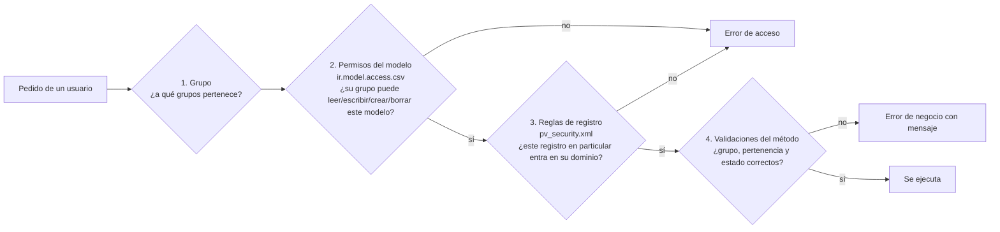

# Seguridad

Odoo controla el acceso en tres capas. Para entender cualquier "no tiene acceso" hay que mirar las tres:



Las capas 2 y 3 son estándar de Odoo: [permisos de acceso](odoo.md#permisos-de-acceso) y [reglas de registro](odoo.md#reglas-de-registro). La capa 4 es propia de este módulo: cada `action_*` vuelve a validar, por si alguien llama al método sin
pasar por la pantalla.

## Grupos

Ver [grupos](odoo.md#grupos) y [usuarios portal](odoo.md#usuarios-internos-y-usuarios-portal).

| Grupo (`posventa.`) | Tipo de usuario | Hereda |
|---|---|---|
| `group_pv_concesionario` — Concesionario | Portal | — |
| `group_pv_staff` — Staff Call Center | Interno | — |
| `group_pv_admin` — Administrador Posventa | Interno | Staff y "Administrar contactos" |

La tabla completa de permisos por modelo y de reglas está en la [referencia generada](referencia.md#permisos-por-modelo).

## Pertenencia a un concesionario

Un usuario pertenece a un concesionario si su contacto **es** la empresa del concesionario o **es un contacto
de esa empresa** (campo *Empresa* del contacto). Está definido en un solo lugar en Python,
`pv.concesionario._get_by_contact()`, y repetido en el dominio de cada regla de `security/pv_security.xml`:

```python
[('concesionario_id.partner_id', 'in', [user.partner_id.id, user.partner_id.commercial_partner_id.id])]
```

Si se cambia uno, hay que cambiar el otro.

**Dar acceso a un empleado del concesionario:** en el backend, abrir el concesionario → botón *Gestionar acceso
al portal* → marcar el contacto → *Otorgar acceso*. El contacto recibe el correo de invitación y queda en los
grupos Portal y Concesionario (`wizard/portal_wizard.py`). Si la persona no figura, primero crearla como
contacto de la empresa del concesionario.

## Lo que ve cada uno

| | Concesionario | Staff | Admin |
|---|---|---|---|
| Máquinas | Las suyas y las que le proponen trasladar | Todas | Todas |
| Certificados | Los que cargó y los de sus máquinas actuales | Todos | Todos |
| Reclamos | Los suyos, en cualquier estado | Todos menos los borradores | Todos |
| Medidas, archivos, campos adicionales | Los de sus reclamos | Todos | Todos |

## Mostrar datos que el usuario no puede leer

Odoo le da al usuario portal **permiso de lectura sobre el modelo** de contactos (`res.partner`), pero con una
[regla de registro](odoo.md#reglas-de-registro) propia de `base` que lo limita a **los contactos de su propia
empresa**. No es una restricción especial del portal: es una regla común, que se ve en Ajustes → Técnico →
Reglas de registro como *"res_partner: portal/public: read access on my commercial partner"*.

El portal necesita mostrar datos de contactos de otras empresas: el cliente final de una máquina, el responsable
de Crucianelli de un reclamo. Leerlos a través del contacto (`maquina.cliente_id.name`) da:

```text
Estos registros están restringidos. ... no tiene acceso 'leer' a: - Contacto (res.partner)
```

La solución es un [campo *related*](odoo.md#campos-related) de texto en el modelo propio:

```python
cliente_nombre = fields.Char(related='cliente_id.name', string='Nombre del Cliente')
```

Odoo calcula los campos *related* como superusuario y los deja de solo lectura. El concesionario obtiene **solo
ese texto**: no ve el contacto ni sus otros datos (email, teléfono, dirección), no puede abrirlo ni modificarlo.
Existen `cliente_nombre` (máquina), `operador_nombre` y `responsable_nombre` (reclamo).

**Si se agrega al portal un dato de otro modelo, usar el mismo recurso** y probarlo en `tests/test_portal.py` con
datos que pertenezcan a otra empresa (los tests con datos de la propia empresa no detectan el problema).

## Diagnosticar un error de acceso

1. Activar el modo desarrollador y repetir la acción. El log del servidor muestra la causa exacta:
   `Access Denied by ACL ...` (capa 2) o `Access Denied by record rules for operation: read on record ids: [...],
   uid: ..., model: ...` (capa 3).
2. Si es la capa 2, el grupo del usuario no tiene permiso sobre ese modelo para esa operación (leer, escribir, crear o borrar): revisar `ir.model.access.csv`.
3. Si es la capa 3, el registro no entra en la regla:
   - ¿El usuario tiene el grupo correcto? (Ajustes → Usuarios).
   - ¿Su contacto tiene como *Empresa* la del concesionario?
   - ¿El modelo que falla es uno del módulo o uno de Odoo (contactos, usuarios)? Si es de Odoo, casi siempre
     es una página que muestra un dato relacionado: aplicar el campo *related* de la sección anterior.
4. Reproducirlo en un test (ver [Recetas](recetas.md#reproducir-un-error-en-un-test)) antes de corregirlo.

## Ver también

- [Conceptos de Odoo](odoo.md): permisos de acceso, reglas de registro, `sudo` y campos related, con ejemplos.
- [Security in Odoo (oficial)](https://www.odoo.com/documentation/19.0/developer/reference/backend/security.html)
- [Tutorial oficial: restringir el acceso a datos](https://www.odoo.com/documentation/19.0/developer/tutorials/restrict_data_access.html)
- [Portales de usuario (oficial)](https://www.odoo.com/documentation/19.0/applications/general/users/user_portals.html)
